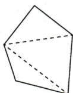
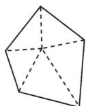
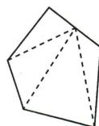

<!-- question-source:start -->
7[2025 山西太原期中]如图,用三种方法分割五边形.

(1)三种分割方法把多边形分成的三角形的个数与多边形的边数有没有关系？若有关系，具体是什么关系？

(2) 若是 $n$ ( $n$ 为大于3的整数) 边形, 请分别写出用上述三种方法分割所得三角形的个数.

图(1)

图(2)

图(3)

电子错题本鸭

建议用时 20 分钟 答案 D14

AI $\xrightarrow{\text{DPSK 原创}}$ 新考法 阅读材料,并解决问题.
<!-- question-source:end -->

![[Q00104060A1]]
