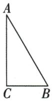
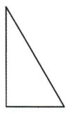
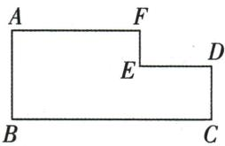

## 综合与实践 确定匀质薄板的重心位置

<table><tr><td>项目主题</td><td colspan="2">确定匀质薄板的重心位置</td></tr><tr><td>项目背景</td><td colspan="2">在学习三角形的重心时,小王向同桌小刘提出这样一个问题:四边形有没有重心?如果有,它的重心如何确定呢?小刘在周末查阅了相关资料,得到如下的信息:1四边形有重心;2在平面内,图形A与图形B拼成一个图形C(无缝隙、不重叠),那么图形C的重心一定在图形A的重心与图形B的重心连接的线段上</td></tr><tr><td rowspan="2">问题探究</td><td>问题1</td><td>如图(1),有两张形状、大小完全相同的直角三角形纸片,其中一张记为Rt△ABC,C为其直角顶点,且 $\frac{BC}{AB}=\frac{1}{2}$ ,将这两个三角形拼成一个四边形(无缝隙、不重叠),使它们的斜边重合.   图(1)请画出所有符合要求的四边形,并作出所画四边形的重心G(用有刻度的直尺作中线,保留作图痕迹并写出结论)</td></tr><tr><td>问题2</td><td>如图(2),一个长方形缺损一个角(缺损部分也是长方形),请画一条直线将该图形分成面积相等的两部分,并简要说明理由  图(2)</td></tr></table>

是个新“烤”鸭
