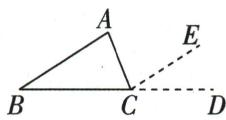

<!-- question-source:start -->
1[2024 山东烟台期中]如图,在证明 $\triangle ABC$ 内角

和等于 $180^{\circ}$ 时，延长 $BC$ 至 $D$ ，过点 $C$ 作 $CE \parallel AB$ ，得到 $\angle ABC = \angle ECD, \angle BAC =$

$\angle ACE$ ，由于 $\angle BCD = 180^{\circ}$ ，可得到 $\angle ABC + \angle ACB + \angle BAC = 180^{\circ}$ ，这个证明方法体现的数学思想是 （）A.数形结合 B.特殊到一般C.一般到特殊 D.转化
<!-- question-source:end -->

![[Q00103294A1]]
