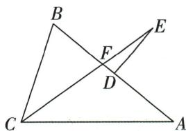
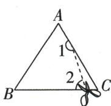

<!-- question-source:start -->
3[2025 福建莆田校级期中]如图, 在 $\triangle ABC$ 中, $\angle A = 40^{\circ}, \angle B = 68^{\circ}, E$ 是 $\triangle ABC$ 的角平分线 $CF$ 延长线上一动点 (不与 $F$ 点重合), 过 $E$ 点作 $ED \perp AB$ 于 $D$ 点, 当 $E$ 点运动时, $\angle E$ 的度数 ( )
A. 随 $E$ 点运动而变化, 离 $F$ 点越近, 度数越大
B. 不变, 为 $16^{\circ}$ C. 随 $E$ 点运动而变化, 离 $F$ 点越远, 度数越大
D. 不变, 为 $14^{\circ}$

(第3题图)

(第4题图)
<!-- question-source:end -->

![[Q00103296A1]]
