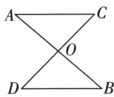
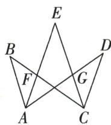

<!-- question-source:start -->
5 [2025 江西南昌质检]【模型理解】(1) 如图(1), AB 和 CD 交于点 O, 求证: $\angle A + \angle C = \angle B + \angle D$ ;

【模型应用】(2)如图(2),AE,CE分别平分 $\angle BAD,\angle BCD$ ，求证： $\angle B + \angle D = 2\angle E.$

图(1)
图(2)
<!-- question-source:end -->

![[Q00103298A1]]
