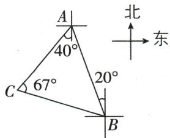
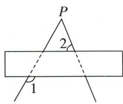

<!-- question-source:start -->
6[2025 河南周口期中]如图所示,以下描述错误的是
( )
A. 点 A 位于点 B 北偏西 $20^{\circ}$ 方向
B. 点 A 位于点 C 北偏东 $40^{\circ}$ 方向
C. 点 C 位于点 B 北偏西 $63^{\circ}$ 方向
D. $\angle ABC = 53^{\circ}$

(第6题图)

(第7题图)
<!-- question-source:end -->

![[Q00103299A1]]
