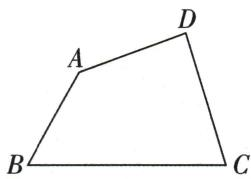

<!-- question-source:start -->
1[2025 山东德州质检, 中]一个零件的形状如图所示, 按照规定, AB 所在直线和 CD 所在直线的夹角为 $40^{\circ}$ 的零件为合格零件. 要检验该零件是否合格, 有以下三种方案:
甲: 延长 BA 和 CD, 设交点为 O, 然后测量 $\angle O$ 是否等于 $40^{\circ}$ 就可以检验该零件是否合格;
乙: 只需测量出 $\angle B$ 和 $\angle C$ 的度数;
丙: 测量出 $\angle BAD$ 和 $\angle ADC$ 的度数也可以检验该零件是否合格.
则正确的方案有 ( )

A.甲、乙、丙 B.甲、乙 C.甲、丙 D.乙、丙
<!-- question-source:end -->

![[Q00103301A1]]
