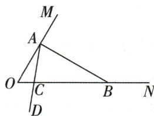

<!-- question-source:start -->
2[2024 河北石家庄裕华区期末, 中]三角形中, 如果一个角是另一个角的 3 倍, 这样的三角形我们称之为“灵动三角形”. 例如, 三个内角分别为 $120^{\circ}, 40^{\circ}, 20^{\circ}$ 的三角形是“灵动三角形”. 如图, $\angle MON = 60^{\circ}$ , 在射线 $OM$ 上找一点 $A$ , 过点 $A$ 作 $AB \perp OM$ 交 $ON$ 于点 $B$ , 以 $A$ 为端点作射线 $AD$ , 交线段 $OB$ 于点 $C(0^{\circ} < \angle OAC < 90^{\circ})$ .

①∠ABO 的度数为 $30^{\circ}$ ;
②△AOB 是“灵动三角形”；
③若 $\angle BAC = 70^{\circ}$ ，则 $\triangle AOC$ 是“灵动三角形”；
④当 $\triangle ABC$ 为“灵动三角形”时， $\angle OAC$ 的度数为 $30^{\circ}$ 或 $52.5^{\circ}$ .
正确的结论有
A.1个 B.2个 C.3个 D.4个
<!-- question-source:end -->

![[Q00103302A1]]
