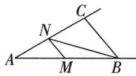

<!-- question-source:start -->
3[2024 江苏宿迁宿城区期末,较难]如图,在 $\triangle ABC$ 中, $\angle ABC=50^{\circ},\angle ACB=100^{\circ},M$ 是射线 $AB$ 上的一个动点,过点 $M$ 作 $MN//BC$ 交射线 AC 于点 N, 连接 BN, 若 $\triangle BMN$ 中有两个角相等, 则 $\angle MNB$ 的度数为 \_\_\_\_.

<!-- question-source:end -->

![[Q00103303A1]]
