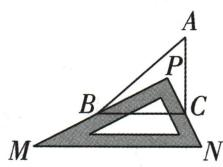
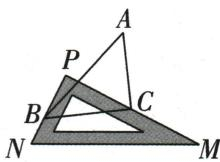

<!-- question-source:start -->
4 核心素养推理能力 [2024 辽宁抚顺期中, 中] 将三角尺 ( $\triangle MPN, \angle MPN = 90^{\circ}$ ) 放置在 $\triangle ABC$ 上 (点 P 在 $\triangle ABC$ 内), 如图 (1) 所示, 三角尺的两边 PM, PN 恰好经过点 B 和点 C. 探究 $\angle ABP$ 与 $\angle ACP$ 是否存在某种数量关系.

(1) 特例探索: 若 $\angle A = 50^{\circ}$ , 则 $\angle PBC + \angle PCB =$ \_\_\_\_ $^{\circ}$ , $\angle ABP + \angle ACP =$ \_\_\_\_ $^{\circ}$ ;

(2) 类比探索: 写出 $\angle ABP, \angle ACP, \angle A$ 之间满足的数量关系, 并说明理由;

(3) 变式探索: 如图 (2), 改变三角尺的位置, 使点 P 在 $\triangle ABC$ 外, 三角尺的两边 PM, PN 恰好经过点 C 和点 B, 写出 $\angle ABP, \angle ACP, \angle A$ 之间满足的数量关系, 并说明理由.

图(1)

图(2)
<!-- question-source:end -->

![[Q00103304A1]]
