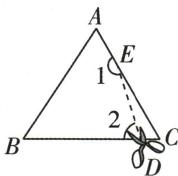

> [!success]- 必刷题
>
> > [!success] **【答案】** D
>
> > [!note]- **【解析】**
> > ∵ $\angle A = 40^{\circ}, \angle B = 68^{\circ}, \angle A + \angle B + \angle BCA = 180^{\circ}, \therefore \angle BCA = 180^{\circ} - 40^{\circ} - 68^{\circ} = 72^{\circ}.$ ∵ CF 平分 $\angle BCA, \therefore \angle BCF = \frac{1}{2} \angle BCA = 36^{\circ}, \therefore \angle BFC = \angle EFD = 180^{\circ} - 36^{\circ} - 68^{\circ} = 76^{\circ}.$ ∵ $ED \perp AB, \therefore \angle FDE = 90^{\circ}, \therefore \angle FED = 180^{\circ} -$
> >
> > $90^{\circ}-76^{\circ}=14^{\circ},\therefore$ 当E点运动时, $\angle E$ 的度数不变,为 $14^{\circ}$ .故选D.
> >
> > 
