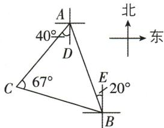
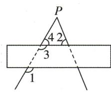

> [!success]- 必刷题
>
> > [!success] **【答案】** C
>
> > [!note]- **【解析】**
> > 如图. 由题意得 $AD \parallel BE$ , $\therefore \angle ABE = \angle BAD = 20^{\circ}$ , $\therefore \angle CAB = 40^{\circ} + 20^{\circ} = 60^{\circ}$ . $\because \angle ACB = 67^{\circ}$ , $\therefore \angle ABC = 180^{\circ} - \angle ACB - \angle BAC = 53^{\circ}$ , $\therefore \angle CBE = \angle ABC + \angle ABE = 73^{\circ}$ . A选项, 点A位于点B北偏西 $20^{\circ}$ 方向, 故A不符合题意; B选项, 点A位于点C北偏东 $40^{\circ}$ 方向, 故B不符合题意; C选项, 点C位于点B北偏西 $73^{\circ}$ 方向, 故C符合题意; D选项, $\angle ABC = 53^{\circ}$ , 故D不符合题意. 故选C.
> >
> > 思路分析
> > 分两种情况进行解答, 即点 M 在线段 AB 上和在 AB 的延长线上, 再根据“ $\triangle BMN$ 中有两个角相等”分情况进行讨论.
> >
> > 
> >
> > 
> > (第6题图)
> > (第7题图)
