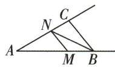
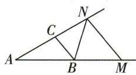

> [!success]- 必刷题
>
> > [!success] **【答案】** $25^\circ$ 或 $50^\circ$ 或 $65^\circ$ 或 $80^\circ$
>
> > [!note]- **【解析】**
> > (1) 当点 M 在线段 AB 上时, 如图 (1). ∵ MN // BC, ∴ $\angle ABC = \angle AMN = 50^{\circ}, \therefore \angle BMN = 180^{\circ} - 50^{\circ} = 130^{\circ}.$ ∵ $\triangle BMN$ 中有两个角相等, ∴ 只有 $\angle MBN = \angle BNM$ 这一种情况, ∴ $\angle MNB = \frac{180^{\circ} - 130^{\circ}}{2} = 25^{\circ}.$
> >
> > 
> > 图(1)
> >
> > 
> > 图(2)
> >
> > (2) 当点 $M$ 在 $AB$ 的延长线上时, 如图 (2). ①当 $\angle BMN = \angle BNM$ 时, 由 $MN // BC$ , 得 $\angle BMN = \angle ABC = 50^\circ$ , $\therefore \angle BNM = 50^\circ$ . ②当 $\angle BMN = \angle MBN$ 时, $\angle BMN = \angle ABC = 50^\circ$ , $\therefore \angle MBN = 50^\circ$ , $\therefore \angle MNB = 180^\circ - 50^\circ - 50^\circ = 80^\circ$ . ③当 $\angle MBN = \angle MNB$ 时, $\angle BMN = \angle ABC = 50^\circ$ , $\therefore \angle MNB = \frac{180^\circ - 50^\circ}{2} = 65^\circ$ . 综上所述, $\angle MNB$ 的度数为 $25^\circ$ 或 $50^\circ$ 或 $65^\circ$ 或 $80^\circ$ , 故答案为 $25^\circ$ 或 $50^\circ$ 或 $65^\circ$ 或 $80^\circ$ .
> >
> > ## 刷素养·
