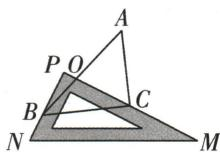

> [!success]- 必刷题
>
> > [!success] **【答案】** 90,40
>
> > [!note]- **【解析】**
> > 【解】(1)∵∠A=50°,∴∠ABC+∠ACB=
> > 130°.∵∠P=90°,∴∠PBC+∠PCB=90°,∴ $\angle ABP + \angle ACP = 130^{\circ} - 90^{\circ} = 40^{\circ}$ ，故答案为90,40.
> >
> > 思路分析
> > 分两种情况讨论: 点 D 为直角顶点; 点 E 为直角顶点.
> >
> > (2) $\angle ABP + \angle ACP = 90^{\circ} - \angle A$ . 理由: $\because (\angle PBC + \angle PCB) + (\angle ABP + \angle ACP) + \angle A = 180^{\circ}, \therefore (180^{\circ} - \angle P) + (\angle ABP + \angle ACP) + \angle A = 180^{\circ}.\because \angle P = 90^{\circ}, \therefore \angle ABP + \angle ACP + \angle A = 90^{\circ}, \therefore \angle ABP + \angle ACP = 90^{\circ} - \angle A.$
> >
> > (3) $\angle ACP - \angle ABP = 90^{\circ} - \angle A.$ 理由：设 $AB$ 交 $PC$ 于 $O$ ，如图. $\because \angle AOC = \angle POB, \therefore \angle ACO + \angle A = \angle P + \angle PBO,$ 即 $\angle ACP + \angle \therefore \angle ACP - \angle ABP = 90^{\circ} - \angle A.$
> >
> > 
> >
> > $\angle P + \angle PBO$ ，即 $\angle ACP + \angle A = 90^{\circ} + \angle ABP$ ∴ $\angle ACP - \angle ABP = 90^{\circ} - \angle A.$
> >
> > ## 课时 2 直角三角形的性质与判定
