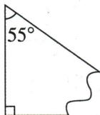
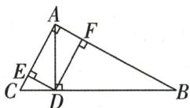

<!-- question-source:start -->
1[2025 黑龙江大庆校级期中]如图,有一个直角三角形纸板破损了一个角,如果把它补成完整的三角形纸板,需要补的角的度数是 ( )
A. $45^{\circ}$ B. $35^{\circ}$ C. $55^{\circ}$ D. $25^{\circ}$

(第1题图)
(第3题图)
<!-- question-source:end -->

![[Q00103305A1]]
