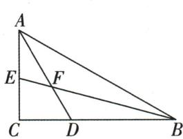
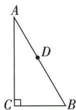

<!-- question-source:start -->
4 如图, 小明在计算机上用“几何画板”画了一个 Rt△ABC, ∠C=90°, 并画出了两锐角的平分线 AD, BE 及其交点 F. 小明发现, 无论怎样变动 Rt△ABC 的形状和大小, ∠AFB 的度数是定值. 这个定值为 \_\_\_\_.

(第4题图)

(第5题图)
<!-- question-source:end -->

![[Q00103308A1]]
