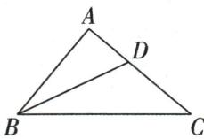

<!-- question-source:start -->
6[2024 陕西汉中期末]如图,在 $\triangle ABC$ 中, $\angle BAC=90^{\circ}$ ,BD平分 $\angle ABC$ .

(1) 若 $\angle C = 40^{\circ}$ , 求 $\angle ADB$ 的度数.

(2) 在图中画出 $\triangle ABC$ 的边 $BC$ 上的高 $AE$ , 与 $BD$ 交于点 $F$ . 试说明: ① $\angle BAE = \angle C$ ; ② $\angle AFD = \angle ADF$ .

<!-- question-source:end -->

![[Q00103310A1]]
