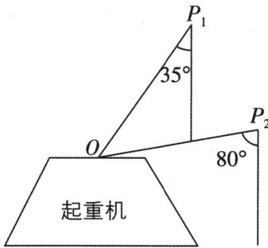
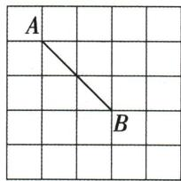

<!-- question-source:start -->
1[2025 山东临沂期末, 中]如图是一台起重机的工作简图, 前后两次吊杆位置 $OP_{1}, OP_{2}$ 与线绳 (线绳垂直于地面) 的夹角分别是 $35^{\circ}$ 和 $80^{\circ}$ , 则吊杆前后两次的夹角 $\angle P_{1}OP_{2}$ 的度数为 ( )
A. $55^{\circ}$ B. $45^{\circ}$ C. $40^{\circ}$ D. $35^{\circ}$

(第1题图)

(第2题图)
<!-- question-source:end -->

![[Q00103314A1]]
