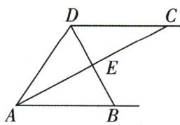

<!-- question-source:start -->
5[2025 浙江杭州质检, 中]如图, $AB \parallel CD$ , $AC$ 平分 $\angle BAD$ , $BD$ 平分 $\angle ADC$ , $AC$ 和 $BD$ 交于点 $E$ . 写出图中所有的直角三角形.

<!-- question-source:end -->

![[Q00103318A1]]
