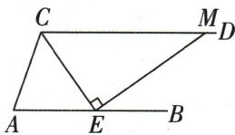
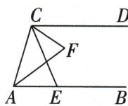
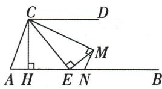

<!-- question-source:start -->
6 核心素养几何直观 [2024 重庆沙坪坝区期末, 较难] 如图, $AB \parallel CD$ , 点 $E$ 是 $AB$ 上一点, 连接 $CE$ . (1) 如图 (1), 若 $CE$ 平分 $\angle ACD$ , 过点 $E$ 作 $EM \perp CE$ 交 $CD$ 于点 $M$ , 试说明 $\angle A = 2 \angle CME$ ; (2) 如图 (2), 若 $AF$ 平分 $\angle CAB$ , $CF$ 平分 $\angle DCE$ , 且 $\angle F = 70^{\circ}$ , 求 $\angle ACE$ 的度数; (3) 如图 (3), 过点 $E$ 作 $EM \perp CE$ 交 $\angle DCE$ 的平分线于点 $M$ , $MN \perp CM$ 交 $AB$ 于点 $N$ , $CH \perp AB$ , 垂足为 $H$ . 若 $\angle ACH = \frac{1}{2} \angle ECH$ , 请直接写出 $\angle MNB$ 与 $\angle A$ 之间的数量关系.

图(1)

图(2)

图(3)

建议用时 20 分钟 答案 D9
<!-- question-source:end -->

![[Q00104059A1]]
