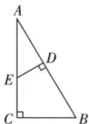
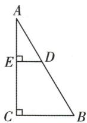

> [!success]- 必刷题
>
> > [!success] **【答案】** $60^{\circ}$ 或 $90^{\circ}$
>
> > [!note]- **【解析】**
> > 当点 D 为直角顶点时, 如图(1)所示, 则 $\angle ADE = 90^{\circ}$ . $\because \angle A = 30^{\circ}$ , $\therefore \angle AED = 90^{\circ} - 30^{\circ} = 60^{\circ}$ .
> >
> > 
> > 图(1)
> >
> > 
> > 图(2)
> >
> > 当点 E 为直角顶点时, 如图(2)所示, 则 $\angle AED = 90^{\circ}$ . 综上, $\angle AED$ 的度数为 $60^{\circ}$ 或 $90^{\circ}$ .
