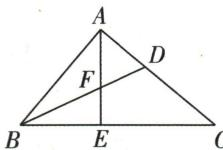

> [!success]- 必刷题
>
> > [!success] **【答案】** C
>
> > [!note]- **【解析】**
> > 【解】(1)在 $\triangle ABC$ 中, $\angle BAC=90^{\circ},\angle C=40^{\circ}$ , $\therefore \angle ABC=90^{\circ}-40^{\circ}=50^{\circ}.\because BD$ 平分 $\angle ABC$ , $\therefore \angle ABD=\angle DBC=\frac{1}{2}\angle ABC=25^{\circ},\therefore \angle ADB=90^{\circ}-\angle ABD=65^{\circ}.$
> >
> > $$
> > \therefore \angle A E C = 9 0 ^ {\circ}, \therefore \angle C +
> > $$
> >
> > 
> >
> > $\angle CAE = 90^{\circ}$ $\because \angle BAC = 90^{\circ},\therefore \angle BAE +$ $\angle CAE = 90^{\circ},\therefore \angle BAE = \angle C.$ ② $\because AE$ 是 $BC$ 边上的高线， $\therefore \angle AEB = 90^{\circ},\therefore \angle DBC + \angle BFE =$ $90^{\circ}.$ $\because \angle BFE = \angle AFD,\angle ABD = \angle DBC,$ $\therefore \angle AFD + \angle ABD = 90^{\circ}.$ $\because \angle ABD + \angle ADF =$ $90^{\circ},\therefore \angle AFD = \angle ADF.$
