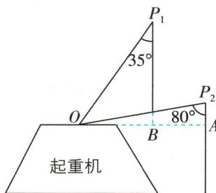

> [!success]- 必刷题
>
> > [!success] **【答案】** B
>
> > [!note]- **【解析】**
> > 如图,由题意知 $P_{1}B, P_{2}A$ 垂直于 OA. 在 $Rt\triangle OAP_{2}$ 中, $\angle AOP_{2}=90^{\circ}-80^{\circ}=10^{\circ}$ , 在 $Rt\triangle OBP_{1}$ 中, $\angle BOP_{1}=90^{\circ}-35^{\circ}=55^{\circ}$ , $\therefore \angle P_{1}OP_{2}=\angle P_{1}OA-\angle P_{2}OA=55^{\circ}-10^{\circ}=45^{\circ}$ . 故选 B.
> >
> > 
