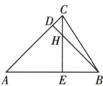
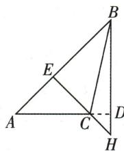

> [!success]- 必刷题
>
> > [!success] **【答案】** $135^{\circ}$ 或 $45^{\circ}$
>
> > [!note]- **【解析】**
> > - **①**：如图(1)， $\triangle ABC$ 是锐角三角形时，∵ BD, CE 是 $\triangle ABC$ 的高线，∴ $\angle ADB = 90^{\circ}$ ， $\angle BEC = 90^{\circ}$ 。在 $\triangle ABD$ 中，∵ $\angle A = 45^{\circ}$ ，∴ $\angle ABD = 90^{\circ} - 45^{\circ} = 45^{\circ}$ 。在 Rt $\triangle BEH$ 中， $\angle EHB = 90^{\circ} - 45^{\circ} = 45^{\circ}$ ，∴ $\angle BHC = 180^{\circ} - \angle EHB = 180^{\circ} - 45^{\circ} = 135^{\circ}$ 。
> >
> > 分 $\triangle ABC$ 是锐角三角形与钝角三角形两种情况讨论, 结合直角三角形的性质求解即可.
> >
> > 
> >
> > 
> > 图(1)
> > 图(2)
> > - **②**：如图(2)， $\triangle ABC$ 是钝角三角形时， $\because BD, CE$ 是 $\triangle ABC$ 的高线， $\therefore \angle A + \angle ACE = 90^{\circ}, \angle BHC + \angle HCD = 90^{\circ}$ . $\because \angle ACE = \angle HCD$ （对顶角相等）， $\therefore \angle BHC = \angle A = 45^{\circ}$ .
> > 综上所述， $\angle BHC$ 的度数是135°或45°.
