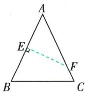
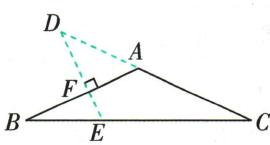

> [!success]- 必刷题
>
> > [!success] **【答案】** $50^{\circ}$ 或 $130^{\circ}$
>
> > [!note]- **【解析】**
> > 分两种情况讨论: ①如图(1), 由折叠的性质可知 $EF \perp AB$ , $\therefore \angle AEF = 90^{\circ}$ . ∵ 折痕所在直线与 AC 边所在直线的夹角为 $40^{\circ}$ , ∴ $\angle AFE = 40^{\circ}$ , ∴ $\angle A = 90^{\circ} - 40^{\circ} = 50^{\circ}$ .
> >
> > 
> >
> > 本题主要考查的是折叠的性质和直角三角形的性质,根据题意画出图形是解题的关键.
> >
> > 图(1)
> > 
> > 图(2)
> > - **②**：如图(2)，由折叠的性质可知 $EF \perp AB$ ，∴ $\angle AFD = 90^{\circ}$ 。∵折痕所在直线与AC边所在直线的夹角为 $40^{\circ}$ ，∴ $\angle D = 40^{\circ}$ ，∴ $\angle DAB = 90^{\circ} - \angle D = 90^{\circ} - 40^{\circ} = 50^{\circ}$ ，∴ $\angle BAC = 180^{\circ} - \angle DAB = 180^{\circ} - 50^{\circ} = 130^{\circ}$ 。故答案为 $50^{\circ}$ 或 $130^{\circ}$ 。
