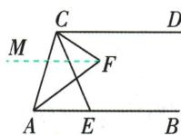
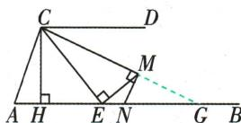

> [!success]- 必刷题
>
> > [!success] **【答案】** 详见解析
>
> > [!note]- **【解析】**
> > 【解】(1)∵ EM ⊥ CE, ∴ ∠CEM = 90°,
> > ∴ ∠ECD + ∠CME = 90°, ∴ 2∠ECD + 2∠CME =
> > 180°. ∵ CE 平分∠ACD, ∴ ∠ACD = 2∠ECD,
> > ∴ ∠ACD + 2∠CME = 180°. ∵ AB // CD, ∴ ∠ACD +
> > ∠A = 180°, ∴ ∠A = 2∠CME.
> >
> > (2)如图(1)，过点 $F$ 作 $FM \parallel AB$ . $\because AB \parallel CD, \therefore FM \parallel AB \parallel CD, \therefore \angle AFM = \angle BAF,$ $\angle CFM = \angle DCF, \therefore \angle AFM + \angle CFM = \angle BAF+$ $\angle DCF$ ，即 $\angle AFC = \angle BAF + \angle DCF.$ ∵ $AF$ 平分 $\angle CAB, CF$ 平分 $\angle DCE, \therefore \angle CAB = 2\angle BAF,$ $\angle DCE = 2\angle DCF, \therefore \angle CAB + \angle DCE = 2(\angle BAF+$ $\angle DCF) = 2\angle AFC.$ ∵ $\angle AFC = 70^{\circ}, \therefore \angle CAB+$ $\angle DCE = 140^{\circ}.$ ∵ $AB \parallel CD, \therefore \angle CAB + \angle ACD=$ $\angle CAB + \angle ACE + \angle DCE = 180^{\circ}, \therefore \angle ACE =$ $180^{\circ} - (\angle CAB + \angle DCE) = 180^{\circ} - 140^{\circ} = 40^{\circ}.$
> >
> > 
> > 图(1)
> >
> > 
> > 图(2)
> >
> > (3) $\angle MNB$ 与 $\angle A$ 之间的数量关系是 $\angle MNB = 135^{\circ} - \angle A$ . 如图(2)，延长 $CM$ 交 $AB$ 于点 $G$ . $\because MN \perp CM, \therefore \angle NMG = 90^{\circ}, \therefore \angle MNB = 90^{\circ} - \angle MGN,$ 同理 $\angle HCG = 90^{\circ} - \angle MGN, \therefore \angle MNB = \angle HCG.$ $\because \angle ACH = \frac{1}{2}\angle ECH, \therefore$ 设 $\angle ACH = x,$ 则 $\angle ECH = 2x.$ $\because CM$ 平分 $\angle DCE, \therefore$ 设 $\angle ECM = \angle DCM = y,$ $\therefore \angle MNB = \angle HCG = 2x + y.$ $\because AB // CD, CH \perp AB, \therefore CH \perp CD, \therefore \angle HCD = 90^{\circ}, \therefore \angle ECH + \angle ECD = 90^{\circ}, \therefore 2x + 2y = 90^{\circ}, \therefore x + y = 45^{\circ}.$ $\because CH \perp AB, \therefore \angle A = 90^{\circ} - \angle ACH = 90^{\circ} - x,$ $\therefore \angle A + \angle MNB = 90^{\circ} - x + 2x + y = 90^{\circ} + x + y = 135^{\circ}, \therefore \angle MNB = 135^{\circ} - \angle A.$
> >
> > ## 13.3.2 三角形的外角
