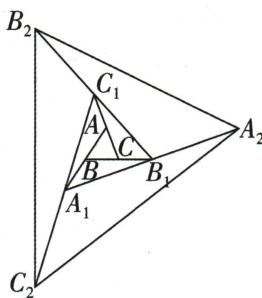

<!-- question-source:start -->
4[2025 辽宁鞍山质检, 中]如图, 已知 $\triangle ABC$ 的面积为 1 , 分别倍长 (延长一倍) 边 $AB, BC, CA$ 得到 $\triangle A_{1}B_{1}C_{1}$ , 再分别倍长边 $A_{1}B_{1}, B_{1}C_{1}, C_{1}A_{1}$ 得到建议用时-40分钟 答案-D4

$\triangle A_{2}B_{2}C_{2},\cdots,$ 按此规律,倍长2024次后得到的 $\triangle A_{2024}B_{2024}C_{2024}$ 的面积为 ( )
A. $7^{2024}$ B. $5^{2024}$ C. $6^{2023}$ D. $4^{2023}$
<!-- question-source:end -->

![[Q00103290A1]]
