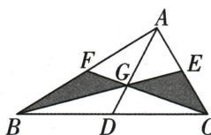

<!-- question-source:start -->
5 [2025 江西景德镇质检, 中]如图, $\triangle ABC$ 的三条中线 $AD, BE, CF$ 交于点 $G$ . 若 $AG:GD=2:1, S_{\triangle ABC}=12$ , 面积为 \_\_\_\_.

若 AG:GD=2:1, $S_{\triangle ABC}=12$ , 则图中阴影部分的面积为 \_\_\_\_.
<!-- question-source:end -->

![[Q00103291A1]]
