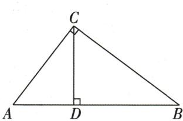
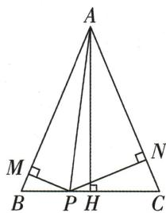

<!-- question-source:start -->
6[2025广西南宁期中,中]我们发现,“用不同的方式表示同一图形的面积”可以解决求线段长度的有关问题,这种方法称为等积法.

(1)如图(1)， $\triangle ABC$ 中， $\angle ACB = 90^{\circ}$ ， $CD$ 是 $AB$ 边上的高，则 $S_{\triangle ABC} = \frac{1}{2} AC \cdot BC = \_$ .

(2) 在(1)的条件下, 若 AC = 3, BC = 4, AB = 5, 用等积法求 CD 的长.

(3)如图(2)，在等腰三角形 $ABC$ 中， $AB = AC = 13, BC = 10$ ，过 $A$ 作 $AH \perp BC$ 于点 $H$ ，且 $AH = 12$ ， $P$ 为底边 $BC$ 上的任意一点，过点 $P$ 作 $PM \perp AB, PN \perp AC$ ，垂足分别为 $M, N$ ，连接 $AP$ ，利用 $S_{\triangle ABC} = S_{\triangle ABP} + S_{\triangle ACP}$ ，求 $PM + PN$ 的值.

图(1)

图(2)

你题还怪好的嘞
<!-- question-source:end -->

![[Q00103292A1]]
