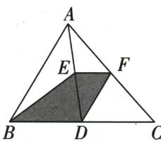

<!-- question-source:start -->
3[中]如图,在 $\triangle ABC$ 中, $D, E, F$ 分别是边 $BC, AD, AC$ 上的中点,若阴影部分的面积是 6, 则 $\triangle ABC$ 的面积是 ( )
A.12 B.14 C.15 D.16

<!-- question-source:end -->

![[Q00104056A1]]
