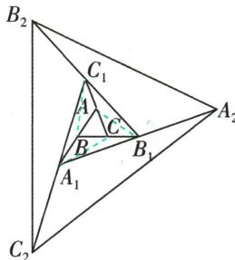

> [!success]- 必刷题
>
> > [!success] **【答案】** A
>
> > [!note]- **【解析】**
> > 如图, 连接 $AB_{1}, BC_{1}, CA_{1}$ , 根据等底同高的三角形面积相等, 可得 $\triangle A_{1}BC$ , $\triangle A_{1}B_{1}C$ , $\triangle AB_{1}C$ , $\triangle AB_{1}C_{1}$ $\triangle ABC_{1}$ , $\triangle A_{1}BC_{1}$ , $\triangle ABC$ 的面积都相等,
> >
> > 
> >
> > $\therefore S_{\triangle A_1B_1C_1} = 7S_{\triangle ABC}$ ，同理可得 $S_{\triangle A_2B_2C_2} = 7S_{\triangle A_1B_1C_1} = 7^2 S_{\triangle ABC}, \dots,$ 则 $S_{\triangle A_2024B_2024C_2024} = 7^{2024}S_{\triangle ABC}.\because S_{\triangle ABC} = 1,\therefore \triangle A_{2024}B_{2024}C_{2024}$ 的面积为 $7^{2024}$ .故选A.
> >
> > 5.4 【解析】∵ AD 是 $\triangle ABC$ 的中线，∴ $S_{\triangle ABD} = S_{\triangle ACD} = \frac{1}{2} S_{\triangle ABC} = \frac{1}{2} \times 12 = 6$ . ∵ AG:GD = 2:1,
> > ∴ $S_{\triangle ABG}=\frac{2}{3}S_{\triangle ABD}=\frac{2}{3}\times6=4,S_{\triangle AGC}=\frac{2}{3}S_{\triangle ACD}=$ $\frac{2}{3}\times6=4$ . 又∵ BE, CF 是 $\triangle ABC$ 的中线, ∴ 点 E, F 分别是 AC, AB 的中点, ∴ $S_{\triangle GFB}=\frac{1}{2}S_{\triangle ABG}=\frac{1}{2}\times4=2,S_{\triangle GCE}=\frac{1}{2}S_{\triangle AGC}=\frac{1}{2}\times4=2$ ,
> > ∴ $S_{阴影}=S_{\triangle GFB}+S_{\triangle GCE}=2+2=4$ . 故答案为 4.
> >
> > 关键点拨
> > 见比设参,利用内角和定理列出方程是解题的关键.
