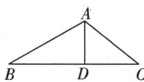
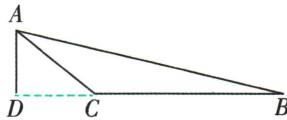

> [!success]- 必刷题
>
> > [!success] **【答案】** D
>
> > [!note]- **【解析】**
> > 当 AD 在 $\triangle ABC$ 内部时, 如图(1).
> > ∵ $\triangle ABC$ 的面积为 24, AD 是 BC 边上的高,
> > AD=4, CD=5, ∴ $\frac{1}{2}BC \cdot AD = \frac{1}{2}(BD + CD) \cdot$ $AD=\frac{1}{2}(BD+5)\times4=24,\therefore BD=7.$
> >
> > 
> >
> > 
> > 图(1)
> > 图(2)
> >
> > 当 $AD$ 在 $\triangle ABC$ 外部时, 如图(2). $\because \triangle ABC$ 的面积为 24, $AD$ 是 $BC$ 边上的高, $AD = 4, CD = 5, \therefore \frac{1}{2} BC \cdot AD = \frac{1}{2} BC \times 4 = 24,$ $\therefore BC = 12, \therefore BD = BC + CD = 12 + 5 = 17.$ 综上所述, $BD$ 的长为 7 或 17, 故选 D.
> >
> > ## 13.3 三角形的内角与外角
> >
> > ## 13.3.1 三角形的内角
> >
> > ## 课时1 三角形的内角
