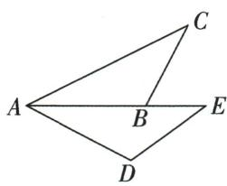
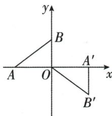

<!-- question-source:start -->
4[2025 浙江宁波期末]如图, $\triangle ABC \cong \triangle ADE$ , 点 $A, B, E$ 在同一条直线上, $AC = 6, BE = 2$ , 则 $AB$ 的长为 ( )
A. 2    B. 4    C. 6    D. 8

建议用时-20分钟 答案-D18

(第 4 题图)

(第5题图)
<!-- question-source:end -->

![[Q00104091A1]]
