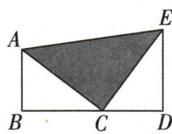

<!-- question-source:start -->
6 如图, 点 $B, C, D$ 在同一条直线上, $\angle B = \angle D = 90^{\circ}$ , $\triangle ABC \cong \triangle CDE$ , $AB = 6$ , $BC = 8$ , $CE = 10$ . (1) 求 $\triangle ABC$ 的周长; (2) 求 $\triangle ACE$ 的面积.

<!-- question-source:end -->

![[Q00104093A1]]
