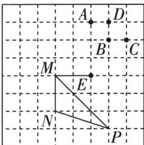
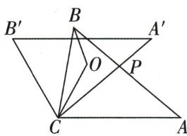

<!-- question-source:start -->
1 [中] 在如图所示的正方形网格图中, 若 $\triangle MNP \cong \triangle MEQ$ , 则点 $Q$ 应是图中的 ( )
A. 点 $A$ B. 点 $B$ C. 点 $C$ D. 点 $D$

(第1题图)

(第2题图)
<!-- question-source:end -->

![[Q00104095A1]]
