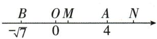
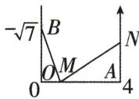

<!-- question-source:start -->
3[2024 重庆沙坪坝区期末, 中]如图(1), 数轴上从左至右依次有 $B, O, A, N$ 四个点, 其中点 $B, O, A$ 表示的数分别为 $-\sqrt{7}, 0, 4$ , 线段 $OA$ 上有一点 $M$ . 如图(2), 将数轴在点 $O$ 的左侧部分绕点 $O$ 顺时针方向旋转 $90^{\circ}$ , 将数轴在点 $A$ 的右侧部分绕点 $A$ 逆时针方向旋转 $90^{\circ}$ , 连接 $BM, MN$ . 若 $\triangle OBM$ 和 $\triangle AMN$ 全等, 则点 $M$ 表示的数为 \_\_\_\_.

图(1)

图(2)
<!-- question-source:end -->

![[Q00104097A1]]
