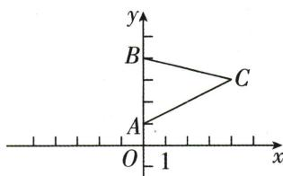

<!-- question-source:start -->
4[中]如图,在 $\triangle ABC$ 中,点 $A$ 的坐标为(0,1),点 $B$ 的坐标为(0,4),点 $C$ 的坐标为(4,3),点 $D$ 在第二象限,且 $\triangle ABD$ 与 $\triangle ABC$ 全等,则点 $D$ 的坐标是\_\_\_\_.

<!-- question-source:end -->

![[Q00104098A1]]
