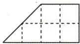
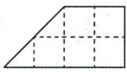

<!-- question-source:start -->
5[2024 山东青岛期末, 中] 图(1)、图(2)都是由边长为 1 的小正方形和腰长为 1 的等腰直角三角形组成的图形.

(1)用实线把图(1)分割成六个全等图形；

(2)用实线把图(2)分割成四个全等图形.

图(1)
图(2)
<!-- question-source:end -->

![[Q00104099A1]]
