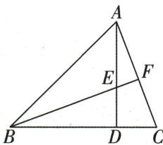

<!-- question-source:start -->
6[2025 山西大同质检, 中]如图, 在 $\triangle ABC$ 中, 点 $D$ 在边 $BC$ 上, 点 $E$ 在边 $AD$ 上, 延长 $BE$ 交 $AC$ 于点 $F$ , 且 $\triangle ACD \cong \triangle BED$ .

(1) 若 $BC = 11, AD = 8$ , 求 $CD$ 的长度;

(2) 求证: $\angle AFE = 90^\circ$ ;

(3) 若 $S_{\triangle BCF} = 20$ , $S_{\text{四边形}CFED} = 8$ , 则 $S_{\triangle AEF} =$ \_\_\_\_.

<!-- question-source:end -->

![[Q00104100A1]]
