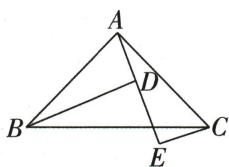

<!-- question-source:start -->
7[2024 山西吕梁期中, 中]如图, A, D, E 三点在同一条直线上, 且 $\triangle BAD \cong \triangle ACE$ .

(1) 求证: $BD = CE + DE$ .

(2) 当 $\angle BAC$ 满足什么条件时, $BD \parallel CE$ ? 并说明理由.

课时 1 两边及夹角证全等（SAS）
<!-- question-source:end -->

![[Q00104101A1]]
