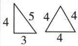
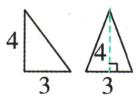
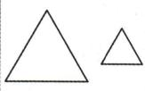

> [!success]- 必刷题
>
> > [!success] **【答案】** B
>
> > [!note]- **【解析】**
> > 根据全等三角形的定义能够判断出 B 选项的说法正确, A、C、D 选项的反例如下:
> >
> > <table><tr><td>选项</td><td>A</td><td>C</td><td>D</td></tr><tr><td>反例</td><td></td><td></td><td></td></tr></table>
