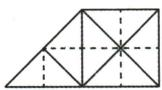
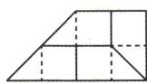

> [!success]- 必刷题
>
> > [!success] **【答案】** 详见解析
>
> > [!note]- **【解析】**
> > 【解】(1)如图(1).根据题意,分成六个等腰直角三角形,且每个三角形的面积为1.
> > (2)如图(2).根据题意,分成四个直角梯形,
> > 且每个梯形的面积为 $\frac{3}{2}$ .
> >
> > 
> >
> > 
> > 图(1)
> > 图(2)
