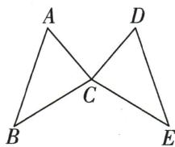

<!-- question-source:start -->
1[2024 山东济南中考]如图, 已知 $\triangle ABC \cong \triangle DEC, \angle A = 60^{\circ}, \angle B = 40^{\circ}$ , 则 $\angle DCE$ 的度数为 ( )

A. $40^{\circ}$ B. $60^{\circ}$ C. $80^{\circ}$ D. $100^{\circ}$
<!-- question-source:end -->

![[Q00104184A1]]
