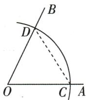
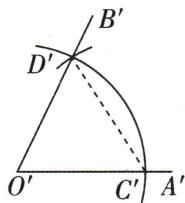

<!-- question-source:start -->
2[2024 北京中考]下面是“作一个角使其等于 $\angle AOB$ ”的尺规作图方法.

(1)如图,以点 O 为圆心,任意长为半径画弧,分别交 OA, OB 于点 C, D.
(2)作射线 $O'A'$ ，以点 $O'$ 为圆心，OC 长为半径画弧，交 $O'A'$ 于点 $C'$ ; 以点 $C'$ 为圆心，CD 长为半径画弧，两弧交于点 $D'$ .

(3) 过点 $D'$ 作射线 $O'B'$ , 则 $\angle A'O'B' = \angle AOB$ .

上述方法通过判定 $\triangle C'O'D' \cong \triangle COD$ 得到 $\angle A'O'B' = \angle AOB$ , 其中判定 $\triangle C'O'D' \cong \triangle COD$ 的依据是 ( )

的依据是 （ ）A.三边分别相等的两个三角形全等B.两边及其夹角分别相等的两个三角形全等C.两角及其夹边分别相等的两个三角形全等D.两角分别相等且其中一组等角的对边相等的两个三角形全等
<!-- question-source:end -->

![[Q00104185A1]]
