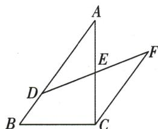

<!-- question-source:start -->
3 [2024 黑龙江牡丹江中考]如图, $\triangle ABC$ 中, $D$ 是 $AB$ 上一点, $CF \parallel AB$ , $D$ , $E$ , $F$ 三点共线, 请添加一个条件\_\_\_\_，使得 AE = CE。（只添一种情况即可）

<!-- question-source:end -->

![[Q00104186A1]]
