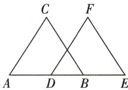

<!-- question-source:start -->
4[2024 四川内江中考]如图, 点 A, D, B, E 在同一条直线上, AD = BE, AC = DF, BC = EF.

(1) 求证: $\triangle ABC \cong \triangle DEF$ ;

(2) 若 $\angle A = 55^{\circ}, \angle E = 45^{\circ}$ , 求 $\angle F$ 的度数.

<!-- question-source:end -->

![[Q00104187A1]]
