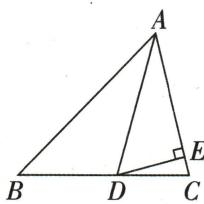
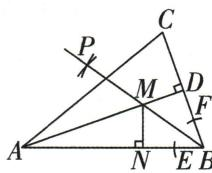

<!-- question-source:start -->
5[2024 四川绵阳中考]如图,在 $\triangle ABC$ 中, $AB=5,AD$ 平分 $\angle BAC$ 交 $BC$ 于点 $D,DE\perp AC$ ,垂足为 $E,\triangle ABD$ 的面积为5,则 $DE$ 的长为( )
A.1 B.2 C.3 D.5

(第 5 题图)

(第6题图)
<!-- question-source:end -->

![[Q00104188A1]]
