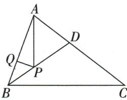
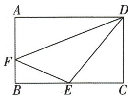

<!-- question-source:start -->
6[2025广西玉林期中]如图所示,在 $\triangle ABC$ 中, $\angle ABC=70^{\circ},BD$ 平分 $\angle ABC,P$ 为线段 $BD$ 上一动点, $Q$ 为边 $AB$ 上一动点,当 $AP+PQ$ 的值最小时, $\angle APD$ 的度数是 ( )
A. $55^{\circ}$ B. $60^{\circ}$ C. $65^{\circ}$ D. $70^{\circ}$

(第6题图)
(第7题图)
<!-- question-source:end -->

![[Q00104195A1]]
