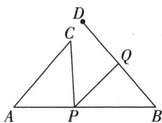

<!-- question-source:start -->
8[2025 浙江台州期中]如图, 已知 AB = 10, AC = 6, BD = 8, 其中 $\angle CAB = \angle DBA = \alpha$ , 点 P 以每秒 2 个单位长度的速度沿着 $C \rightarrow A \rightarrow B$ 路径运动, 同时, 点 Q 以每秒 x 个单位长度的速度沿着 $D \rightarrow B \rightarrow A$ 路径运动, 一个点到达终点后另一个点立即停止运动, 它们的运动时间为 t 秒.
①若 x=1，则点 P 运动路程始终是点 Q 运动路程的 2 倍；
②若 P, Q 两点同时到达 A 点，则 x=5;
③若 $\alpha=90^{\circ}, t=5, x=1$ ，则 PC 与 PQ 垂直；
④若 $\triangle ACP$ 与 $\triangle BPQ$ 全等，则 $x=\frac{4}{5}$ 或 $\frac{4}{11}$ .
以上说法正确的个数为 （）

A. 1 B. 2 C. 3 D. 4
<!-- question-source:end -->

![[Q00104197A1]]
