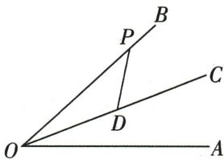

<!-- question-source:start -->
9[2025 北京大兴区期末]如图, OC 是 $\angle AOB$ 的平分线, 点 D, P 分别在射线 OC 和 OB 上, OD>

DP 且 $\angle DPO = 36^{\circ}$ ，点 Q 是射线 OA 上的一点，若 DQ = DP，则 $\angle DQO$ 的度数为 \_\_\_\_.

<!-- question-source:end -->

![[Q00104198A1]]
